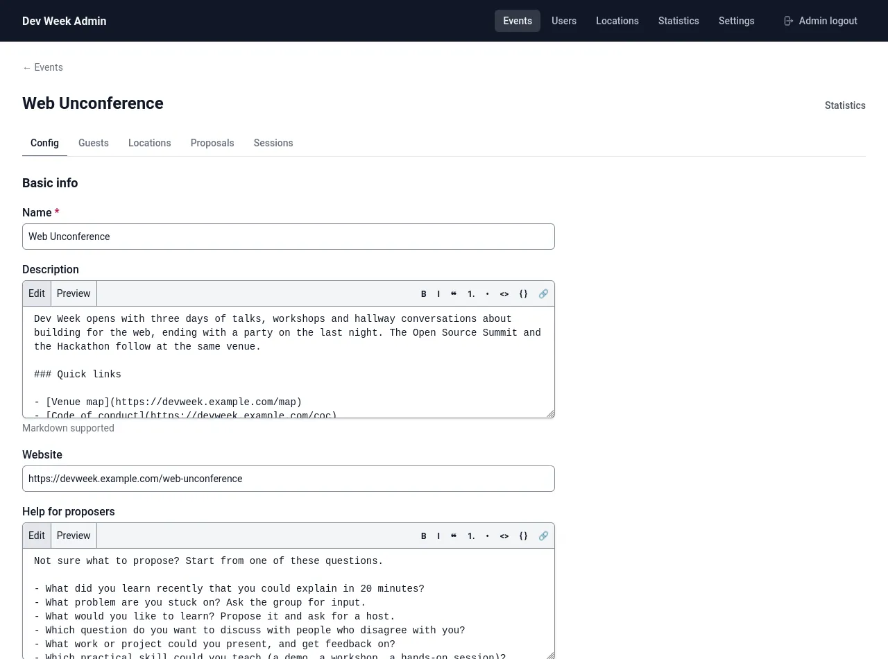
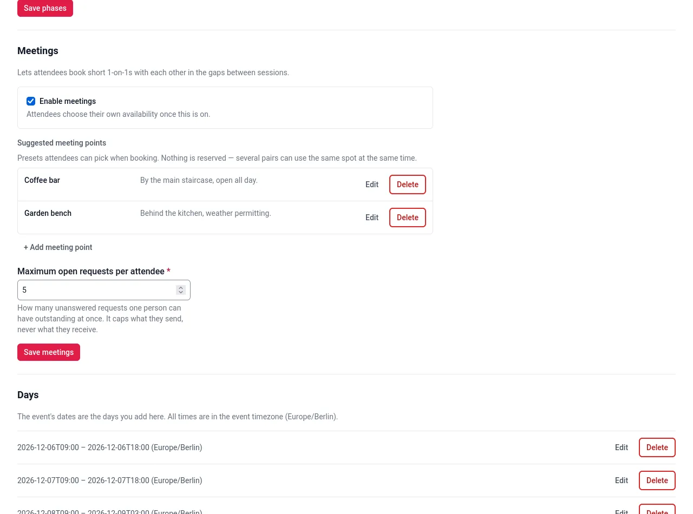
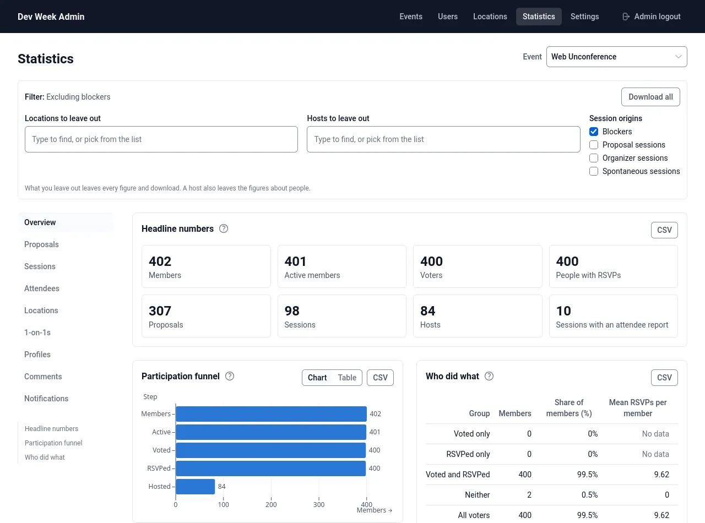

# Admin UI guide

The admin UI lives at `/admin`. It opens for [site admins](#site-admins), who sign in there with
their username or email and a password. When the site has a `SITE_PASSWORD`, enter that first.

A site admin keeps the access until the role is removed or their sessions are ended; changing their
password signs them out everywhere. The site password's cookie stays valid for up to a week: rotate
`AUTH_SECRET` to end it sooner, which logs out the site gate only.

## Site admins

A site admin is a person who opens `/admin` after signing in with a password or an emailed code.
There is no shared admin password any more; a server that still sets `ADMIN_PASSWORD` logs a
warning, and the setting does nothing. A site admin's name is protected, and changes they make are
recorded under their name.

A join link never gives admin rights. A site admin signed in by one acts as an attendee, and
`/admin` asks them to sign in with their password. A site admin's password changes only with the old
one or through a reset link; they cannot set one without it.

- **The first site admin**: while the site has none, the server logs a one-time link at start (valid
  24 hours). Open it, choose your name or enter a name and email, and set a username and password.
  To get a new link later, set `SB_BOOTSTRAP_LINK=1` for one start. A person the
  [sign-in proxy](../self-hosting/proxy-sign-in.md) identifies sees only a note and a button, and
  becomes the site admin themselves, with no username or password. This works only while **Site
  admins sign in through the proxy too** is on; otherwise the link is refused and kept, and you set
  `SB_DISABLE_PROXY_SIGN_IN=1` to use the form.
- **Make site admin / Remove site admin**: on the Users page, per user. The last site admin cannot
  be removed. A site admin who has not set a password yet is marked "No password yet" and signs in
  with a reset link.

## Site settings

One global row shown when there's more than one event (see
[multi-event installs](how-it-works.md#multi-event-installs)):

- **Title** (required) and **Description** (Markdown) for the landing page. The title also names the
  browser tab and the installed app.
- **Map image** — JPEG/PNG/WebP, max 5 MB.

### Sign-in through a proxy

If a sign-in proxy such as oauth2-proxy or Authelia sits in front of the site, this card lets it
identify attendees, so nobody picks a name or enters a code. Set the proxy up first, following
[Sign-in through a proxy](../self-hosting/proxy-sign-in.md). The card is off by default. If a
setting locks everyone out, see
[If you lock yourself out](../self-hosting/proxy-sign-in.md#if-you-lock-yourself-out).

- **Header with the email** — the request header that carries the person's email. The email must
  match the **system email** of a guest; a contact email typed into a profile never counts. A
  request without the header signs in the normal way, and a request with an unknown email carries on
  without a name.
- **Secret** — **Make secret** shows a value once; configure the proxy to send it in the
  `X-SchellingBoard-Proxy-Secret` header. Requests without it are not signed in. **Replace secret**
  makes a new one, **Remove secret** stops requiring it.
- **Proxy addresses** — IP addresses or ranges of the proxy. If you set both a secret and addresses,
  a request needs both.
- **Sign out address** — where **Sign out** leads (the proxy's logout page). Empty hides **Sign
  out**.
- **Site admins sign in through the proxy too** — off by default: a site admin behind the proxy is a
  normal person and signs in with a password to administer.
- **Create people the site does not know** — off by default: a person whose email matches no guest
  sees a notice. On, they are made at their first visit and confirm their name in a **Your name**
  window. **Header with the name** (optional) gives the name; otherwise the part of the email before
  the `@` is used.

The card lists the events that proxy people join. Switch an event on in its settings, see below.

While the sign-in is on and neither a secret nor an address is set, the card shows a warning: anyone
who reaches the app without the proxy can send the header and become any person. Under the card, a
line tells you what your own request to the page carried (header missing, header trusted, or header
ignored), so a wrong setup is visible at once.

## Events

- **Name** (required) — the URL slug is derived from the name once, at creation, and never changes
  afterwards even if you rename the event later. This keeps existing links/bookmarks working.
  `admin`, `api`, `login`, and `media` can't be used as event names.
- **Description** (Markdown), **Website**, **Timezone** (required, type to search — all dates/times
  for this event are edited in this zone), **Icon** (shown beside the event's name in the menu and
  on the home page; hover an icon to see its name).
- **Help for proposers** (Markdown) — the text behind the **Need ideas?** button on the proposals
  page and the new-proposal form. It starts as a default list of prompts; **Reset to default**
  brings it back.
- **Max session duration**, **break before each session** (attendees' sessions start this long into
  their slot; changing it affects only sessions booked afterwards), **schedule increment** (15/30/60
  min grid granularity — can't be changed if it would misalign existing days).
- **Identity** — _Verified_ (the default for new events): everyone taking part must prove who they
  are, with their personal join link, an emailed code or a password, and picking a name is not
  enough. _Open_: anyone can pick any name and act as that person. Existing events stay _Open_.
  Someone who takes part in any verified event needs proof in all of their events.
- **People who sign in through the proxy join this event** — off by default. When on, everyone the
  [proxy](#sign-in-through-a-proxy) signs in becomes a member, new and existing people alike. A
  member you remove returns after the next change of this switch or server restart.
- **Enforce session capacity as a hard limit** — when on, RSVPs are rejected once a session's
  capacity is reached; otherwise capacity is advisory only.
- **Phases** — the three phase date ranges, see [How it works](how-it-works.md#the-three-phases).
- **Meetings** — 1-on-1s between attendees, off by default, and open only during the scheduling
  phase. Once switched on: **suggested meeting points**, a named list with optional descriptions
  that attendees pick from when booking, and a **maximum open requests per attendee**, limiting how
  many unanswered requests one person may have outstanding to others at a time. Meeting slots are
  the same length as the schedule increment above, and run for the whole of each day; attendees
  clear the ones they want kept free. Changing the schedule increment therefore asks everyone to
  choose their availability again. Meeting points are suggestions, not reservations — several pairs
  can name the same spot in the same slot, and an attendee can type somewhere else instead. Renaming
  or deleting one never changes a meeting already arranged there.
- **Days** — per-day schedule windows, which also make up the event's dates: visible Start/End time
  range, plus a separate Bookings open/close window controlling when attendees can self-book a blank
  bookable slot on that day (a new day starts with the same window as its Start/End until you change
  it). Deleting a day also deletes any sessions scheduled inside it (warned before confirming);
  their hosts and the guests who RSVPed to them are notified. A day may end after midnight (e.g.
  Friday 09:00 → Saturday 03:00). Since a session always belongs to exactly one day, that is how you
  allow late-night sessions: extend the evening's day into the small hours instead of adding a
  separate day for them. Hosts then pick that day and a time such as 01:00, and the session is
  scheduled on the following calendar date.
- **Shared moments** — a time everyone is invited to share, such as lunch or a keynote. Give it a
  title, optional details, a start and end time and the days it happens on (all ticked by default,
  one moment per day, each edited or deleted on its own). It blocks nothing; to make a time
  unbookable, add a blocker session in every room instead. Deleting a day deletes its moments.
- **Deleting an event** requires typing the event name to confirm, and cascades to its days,
  proposals, sessions, RSVPs, and guest/location assignments.

## Locations

Locations are a **global pool**, not per-event — one location can be assigned to multiple events.
The event's "Locations" tab assigns rooms from this pool and sets
[when they are unavailable](#location-unavailability); it doesn't create new ones.

- **Name, Capacity, Description, Area description, Color** (schedule grid). The description is what
  a room offers (projector, whiteboard, seating); attendees open it from the ⓘ next to the room
  name.
- **Bookable** — whether attendees can self-book blank slots here. A location that isn't bookable
  still shows on the grid and you can schedule sessions into it yourself; attendees just can't pick
  it.
- **Image** — JPEG/PNG/WebP, max 15 MB, any size. It is cropped to 4:3 around its centre.
- **Sort order** — controls column order in the grid.
- **Deleting a location** requires typing the name to confirm; the dialog shows how many
  sessions/events reference it before it cascades. The hosts of sessions in it and the guests who
  RSVPed to them are notified that the session changed.

Attendees are only ever offered the locations assigned to the event they are in and that are
bookable — everything else is refused. To take a location off an event's grid without deleting it,
unassign it from the event.

### Location unavailability

Below the assignments on the event's "Locations" tab, mark the times a location can't be used at
this event — a room only free on Saturday, or closed in the afternoon. Tick one or more locations
(or **All locations**) and pick a start and end, or fill in a whole day with one click. Each ticked
location gets its own entry. Attendees aren't offered those slots, and the grid shows them empty, as
before bookings open. You can still place a session there yourself.

Use this rather than a **blocker** session when attendees don't need to know why. Something they
should see on their schedule, such as lunch, stays a blocker.

**Keep slots free for spontaneous sessions:** mark a room unavailable for that time, or add a
blocker session there titled e.g. "Reserved for spontaneous sessions" so attendees know why. Nobody
can book it in advance. Shortly before the time, delete the entry; the room is then open to
attendees for sessions added on the spot.

## Guests / Users

Guests are also a **global pool** (Name, Email — unique when set, Username, About me, Pronouns,
Avatar), independent of any event. The email may be left empty, which suits a site that sends no
mail; such a guest gets no emails and signs in with a personal join link. A **username** lets a
guest sign in with it and a password instead of their email. Per-event participation is a separate
assignment on the event's "Guests" tab, or by ticking events in the add and edit forms on the Users
page. The ticked events stay ticked after "Add user", so adding several guests to the same events is
quick; saving an edit sets the guest's events to those ticked.

- **A guest must be assigned to an event before they can vote, RSVP, or add a proposal/session in
  it** — being in the global list isn't enough. This is enforced server-side.
- There are no roles — every assigned guest has identical capabilities.
- **CSV import**: header row needs `name` and `email` columns (any order, delimiter auto-detected:
  comma, semicolon, or tab). The whole file is rejected if any row is invalid (line numbers given).
  An empty email makes a user without one. Existing users (matched by email, or by exact name when
  the email is empty) aren't recreated but are still assigned to the events selected in the import.
- **Send test email** — see [How it works § Email](how-it-works.md#email).
- Attendees edit their own About me/Pronouns/Avatar from a profile page once they've picked their
  name; admins don't set these.

### Labels

An event's **Guests** tab has a **Labels** section for tags such as "Orga team", "Volunteer" or
"Sponsor": a name, an optional description (shown on hover) and one of eight colours. Give a label
to a guest in the **Labels** column of the guest list above it, or in the Users edit form, under
"Labels in" each event the guest is in. Attendees see the labels as badges on the directory and
profiles, only for the events they are in. Deleting a label removes it from everyone.

### Personal join links

On an event's **Guests** tab, **New link** makes a personal link for one guest: copy it into a
messenger and send it. **Mail new links** emails a link to every guest of the event, or only to the
ones you ticked; guests without an email are counted and skipped.

- **A link signs its guest in and adds them to the event.** It asks for a sign-in instead once the
  guest has set a password after the link was made, and always for a site admin.
- **A new link replaces the guest's earlier one** for that event, and the guest is emailed that a
  new link exists. A link is shown once; make a new one if you lost it.
- **A guest who forgot their password and cannot get email** (no address on file, or a site that
  sends none) gets back in with a new link, then sets a new password under **Settings → Account
  security** without the old one. Only a link login can do this, and never for a site admin. Whoever
  has the link can do it, so share it privately. Other guests reset by email.

### Attendees who protect their name

In an _Open_ event, any attendee can opt into [name protection](how-it-works.md#attendee-identity)
from their own settings. You can't turn it on or off for someone; to require proof of identity from
everyone, make the event _Verified_.

The one thing you _can_ do is fix a lockout. Protection is anchored to the guest's email address, so
an attendee who's lost both their password and their mailbox is stuck until you **change their email
address here** — codes then go to the new address and they can unlock themselves. **Verify who
you're talking to first; this is effectively a password reset.**

Deleting and recreating the guest also clears protection, but discards their votes, RSVPs, and
profile — prefer changing the email.

## Proposals

Admins can **edit** a proposal's title, description, duration, and host list, and **delete** it
(confirm dialog shows how many votes/host-links will be destroyed). There's no separate
approve/reject step — proposals are visible and votable as soon as attendees submit them.

**Create session** on a proposal opens the session form with its title, description and hosts filled
in, and the end follows the start by the proposal's duration until you type one. It works in any
phase. The session is linked to the proposal, so the proposal shows it as scheduled. Set the day,
time and room there, or leave it unscheduled.

## Sessions

Admins can create/edit/delete sessions directly, outside the normal proposal → schedule flow.

- **Title** (required), **Description** (Markdown), **Day** and **Start/End time** (any minute, not
  just the schedule increment; on a day that runs past midnight, 01:00 is the next morning; pick
  "Not scheduled" to leave a session off the schedule), **Capacity** (0 means no limit; a new
  session in one room takes the room's capacity until you type one), **Hosts**, **Locations** (**All
  locations** ticks every location, e.g. for a blocker).
- **Break before** — when creating a session, the event's break is added to the start you enter, as
  for attendees' sessions. Untick it for a session that should start right away, such as an opening
  keynote.
- **Blocker** — something attendees should see on the schedule but can't attend as a session, such
  as lunch. To just take a room out of use, see [Location unavailability](#location-unavailability).
- **Closed** — an attendee-facing note that latecomers shouldn't join; it does _not_ restrict RSVPs.
- **Admin-managed** — checked by default for admin-created sessions; hosts can't edit or delete an
  admin-managed session themselves, only the admin panel can.
- **Duplicate** opens a new session form filled in from an existing session. To put lunch on every
  day, create it once, then duplicate it and change the Day.
- The **No hosts** box above the list shows only the sessions nobody hosts. Any attendee can take
  over such a session, unless it is admin-managed.
- Deleting a session removes its RSVPs but only unlinks (doesn't delete) hosts/locations. Admins can
  also remove a single guest's RSVP from the session's RSVP list.
- If a host or another admin saved the session or proposal while you had its form open, your save is
  refused rather than undoing their change. Copy your edits, cancel, and edit again. The same holds
  for event settings, days, locations, meeting points and guests. On the event page, save a section
  before you edit the next one: saving one section refuses the save of another section that already
  has unsaved edits.

## Statistics

**Statistics** in the admin menu answers how an event went: did proposals turn into sessions, did
the venue work, which features did people use. It opens the event running or run last; choose
another in **Event** (type to narrow the list). An event's admin page links to its statistics too.

Each figure is a card with a title; its **?** button explains what it shows and how to read it. Most
cards draw a chart, and **Table** next to it shows the figures behind it: sort by clicking a column.
A long table shows 50 rows at a time, and its search box finds rows by their text. **CSV** saves the
whole table, **Download all** every table as a ZIP. On a wide screen the sections and the figures of
the open section are listed on the left. A figure the database cannot supply, such as attendee
counts for an event that ran before they existed, says "No data" instead of 0. The page counts what
the database holds now, so it works for a past event after an upgrade.

### Filter

The filter above the figures leaves things out of every figure: type in **Locations to leave out**
or **Hosts to leave out** to find one, and tick kinds of session (blockers are left out by default).
**Reset filter** goes back to the default. A typical use is leaving out volunteer shifts so that
they do not skew attendance. The filter lives only in the page address, so a link keeps it and
nothing is saved.

- A session or proposal leaves when all of its hosts are left out; a session also leaves when all of
  its locations, or its kind, are.
- A host you leave out also leaves the figures about people: their votes, RSVPs, comments, profile
  and 1-on-1s. Only people who host sessions appear in the host list.
- A room still counts as occupied by a left-out session or blocker, so the gaps in the Locations
  figures stay true.
- Downloads carry the filter, and their file names say "filtered".

### Sections

- **Overview**: headline numbers, the participation funnel from members to hosts, and how many
  members voted, RSVPed, both or neither.
- **Proposals**: one row per proposal with its votes, rank and what became of it, popular proposals
  that were never scheduled, whether late proposals got fewer votes, and votes per voter.
- **Sessions**: RSVPs, fill, reported attendees, duration, start hour and day, parallel sessions,
  and whether hosts reported attendance. It also compares the attendance model's prediction with the
  reported counts.
- **Attendees**: RSVPs per attendee, the gaps between RSVPed sessions and double bookings.
- **Locations**: booked and free hours, gaps, utilization by hour and day, and parallel sessions
  against RSVPs by hour. Use it to plan next year's grid.
- **1-on-1s**: availability offered, requests by status, response time, accepted meetings by hour
  and meeting points. This section appears only if the event uses, or used, 1-on-1s.
- **Profiles**, **Comments** and **Notifications**: how many members filled in which profile fields,
  comments by what they are on and per day, and email, push and in-app notification use. Profiles
  and Comments appear only when the event has such data.

### Read the figures with care

- **RSVPs are intent, not attendance.** Attendee counts are typed in by hosts, are rough, and exist
  only for sessions whose host reported one. Check "did hosts report?" in Sessions first: it tells
  you how far to trust every attendance figure.
- **The prediction is a rough guide.** The attendance model was fitted on one event (13 sessions).
  The page labels it so, and shows how often the reported counts fell inside its ranges.
- **Correlations need many sessions.** With fewer than 15 sessions (pairs) the page says it is too
  few to say anything. A correlation does not show that one thing caused the other.
- **Votes and RSVPs have no history.** The page cannot show how either grew over time, and a
  cancelled RSVP leaves no trace.
- **Response times for 1-on-1s are partial.** A later cancel overwrites the time of the answer, so
  only requests still accepted or declined are timed. A pending request counts as expired once its
  slot has started.
- **Comments on a profile have no event.** On a site with several events they count in every event
  the member belongs to. In-app notifications likewise count all events of the members, and a
  notification someone deleted unread is not counted, so the read share is a lower bound.

### Privacy

Tables about people list rows without names or ids: each person is "P001", "P002", and so on, sorted
by value. The numbering changes with every table and every request, so rows cannot be joined across
tables or matched to a person. Free text, such as languages and places in profiles, is shown only
when at least three members share it; the rest is "Other". Contact details and meeting places people
typed are never shown. Statistics are visible to site admins only.
