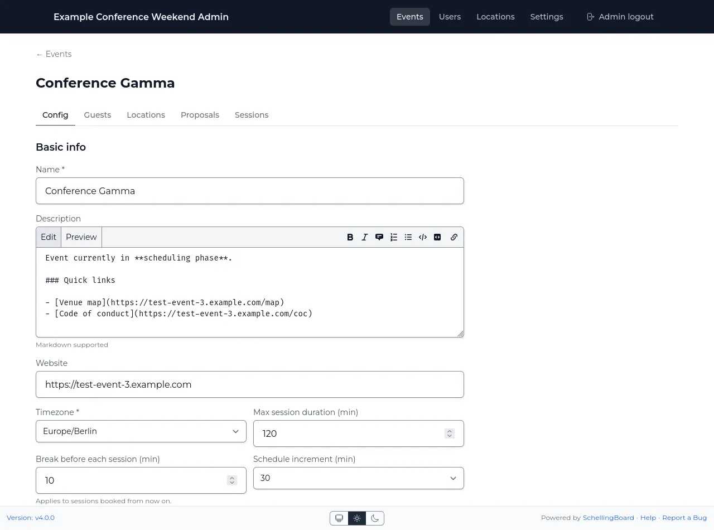
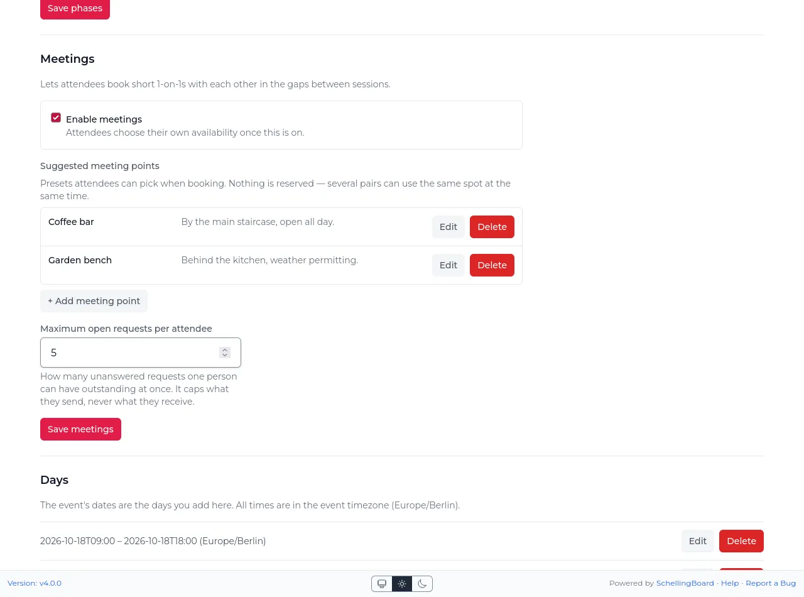

# Admin UI guide

The admin UI lives at `/admin`. It opens for [site admins](#site-admins), who sign in there with
their username or email and a password. When the site has a `SITE_PASSWORD`, enter that first.

A site admin keeps the access until the role is removed or their sessions are ended; changing their
password signs them out everywhere. The site password's cookie stays valid for up to a week: rotate
`AUTH_SECRET` to end it sooner, which logs out the site gate only.

## Site admins

A site admin is a person who opens `/admin` after signing in with a password or an emailed code.
There is no shared admin password any more; a server that still sets `ADMIN_PASSWORD` logs a
warning, and the setting does nothing. A site admin's name is protected, and changes they make are
recorded under their name.

- **The first site admin**: while the site has none, the server logs a one-time link at start (valid
  24 hours). Open it, choose your name or enter a name and email, and set a username and password.
  To get a new link later, set `SB_BOOTSTRAP_LINK=1` for one start.
- **Make site admin / Remove site admin**: on the Users page, per user. The last site admin cannot
  be removed. A site admin who has not set a password yet is marked "No password yet" and signs in
  with a reset link.

## Site settings

One global row shown when there's more than one event (see
[multi-event installs](how-it-works.md#multi-event-installs)):

- **Title** (required) and **Description** (Markdown) for the landing page.
- **Map image** — JPEG/PNG/WebP, max 5 MB.

## Events

- **Name** (required) — the URL slug is derived from the name once, at creation, and never changes
  afterwards even if you rename the event later. This keeps existing links/bookmarks working.
  `admin`, `api`, `login`, and `media` can't be used as event names.
- **Description** (Markdown), **Website**, **Timezone** (required — all dates/times for this event
  are edited in this zone), **Icon** (decorative).
- **Max session duration**, **break before each session** (attendees' sessions start this long into
  their slot; changing it affects only sessions booked afterwards), **schedule increment** (15/30/60
  min grid granularity — can't be changed if it would misalign existing days).
- **Enforce session capacity as a hard limit** — when on, RSVPs are rejected once a session's
  capacity is reached; otherwise capacity is advisory only.
- **Phases** — the three phase date ranges, see [How it works](how-it-works.md#the-three-phases).
- **Meetings** — 1-on-1s between attendees, off by default, and open only during the scheduling
  phase. Once switched on: **suggested meeting points**, a named list with optional descriptions
  that attendees pick from when booking, and a **maximum open requests per attendee**, limiting how
  many unanswered requests one person may have outstanding to others at a time. Meeting slots are
  the same length as the schedule increment above, and run for the whole of each day; attendees
  clear the ones they want kept free. Changing the schedule increment therefore asks everyone to
  choose their availability again. Meeting points are suggestions, not reservations — several pairs
  can name the same spot in the same slot, and an attendee can type somewhere else instead. Renaming
  or deleting one never changes a meeting already arranged there.
- **Days** — per-day schedule windows, which also make up the event's dates: visible Start/End time
  range, plus a separate Bookings open/close window controlling when attendees can self-book a blank
  bookable slot on that day. Deleting a day also deletes any sessions scheduled inside it (warned
  before confirming); guests who RSVPed to them are notified. A day may end after midnight (e.g.
  Friday 09:00 → Saturday 03:00). Since a session always belongs to exactly one day, that is how you
  allow late-night sessions: extend the evening's day into the small hours instead of adding a
  separate day for them. Hosts then pick that day and a time such as 01:00, and the session is
  scheduled on the following calendar date.
- **Deleting an event** requires typing the event name to confirm, and cascades to its days,
  proposals, sessions, RSVPs, and guest/location assignments.

## Locations

Locations are a **global pool**, not per-event — one location can be assigned to multiple events.
The event's "Locations" tab assigns rooms from this pool and sets
[when they are unavailable](#location-unavailability); it doesn't create new ones.

- **Name, Capacity, Description, Area description, Color** (schedule grid). The description is what
  a room offers (projector, whiteboard, seating); attendees open it from the ⓘ next to the room
  name.
- **Bookable** — whether attendees can self-book blank slots here. A location that isn't bookable
  still shows on the grid and you can schedule sessions into it yourself; attendees just can't pick
  it.
- **Image** — JPEG/PNG/WebP, max 5 MB, min 400px wide, **must be 4:3** (±2% tolerance).
- **Sort order** — controls column order in the grid.
- **Deleting a location** requires typing the name to confirm; the dialog shows how many
  sessions/events reference it before it cascades. Guests who RSVPed to sessions in it are notified
  that the session changed.

Attendees are only ever offered the locations assigned to the event they are in and that are
bookable — everything else is refused. To take a location off an event's grid without deleting it,
unassign it from the event.

### Location unavailability

Below the assignments on the event's "Locations" tab, mark the times a location can't be used at
this event — a room only free on Saturday, or closed in the afternoon. Tick one or more locations
(or **All locations**) and pick a start and end, or fill in a whole day with one click. Each ticked
location gets its own entry. Attendees aren't offered those slots, and the grid shows them empty, as
before bookings open. You can still place a session there yourself.

Use this rather than a **blocker** session when attendees don't need to know why. Something they
should see on their schedule, such as lunch, stays a blocker.

## Guests / Users

Guests are also a **global pool** (Name, Email — unique, About me, Pronouns, Avatar), independent of
any event. Per-event participation is a separate assignment on the event's "Guests" tab.

- **A guest must be assigned to an event before they can vote, RSVP, or add a proposal/session in
  it** — being in the global list isn't enough. This is enforced server-side.
- There are no roles — every assigned guest has identical capabilities.
- **CSV import**: header row needs `name` and `email` columns (any order, delimiter auto-detected:
  comma, semicolon, or tab). The whole file is rejected if any row is invalid (line numbers given).
  Existing users (matched by email) aren't recreated but are still assigned to the events selected
  in the import.
- **Send test email** — see [How it works § Email](how-it-works.md#email).
- Attendees edit their own About me/Pronouns/Avatar from a profile page once they've picked their
  name; admins don't set these.

### Personal join links

On an event's **Guests** tab, **New link** makes a personal link for one guest: copy it into a
messenger and send it. **Mail new links** emails a link to every guest of the event, or only to the
ones you ticked; guests without an email are counted and skipped.

- **A link signs its guest in and adds them to the event.** It asks for a sign-in instead once the
  guest has set a password after the link was made, and always for a site admin.
- **A new link replaces the guest's earlier one** for that event, and the guest is emailed that a
  new link exists. A link is shown once; make a new one if you lost it.
- **A guest without email who forgot their password** gets back in with a new link.

### Attendees who protect their name

Any attendee can opt into [name protection](how-it-works.md#attendee-identity) from their own
settings. There is no admin control over this: you can't require it, and you can't turn it off for
someone.

The one thing you _can_ do is fix a lockout. Protection is anchored to the guest's email address, so
an attendee who's lost both their password and their mailbox is stuck until you **change their email
address here** — codes then go to the new address and they can unlock themselves. **Verify who
you're talking to first; this is effectively a password reset.**

Deleting and recreating the guest also clears protection, but discards their votes, RSVPs, and
profile — prefer changing the email.

## Proposals

Admins can **edit** a proposal's title, description, duration, and host list, and **delete** it
(confirm dialog shows how many votes/host-links will be destroyed). There's no separate
approve/reject step — proposals are visible and votable as soon as attendees submit them.

## Sessions

Admins can create/edit/delete sessions directly, outside the normal proposal → schedule flow.

- **Title** (required), **Description** (Markdown), **Day** and **Start/End time** (any minute, not
  just the schedule increment; on a day that runs past midnight, 01:00 is the next morning; pick
  "Not scheduled" to leave a session off the schedule), **Capacity** (0 means no limit; a new
  session in one room takes the room's capacity until you type one), **Hosts**, **Locations** (**All
  locations** ticks every location, e.g. for a blocker).
- **Break before** — when creating a session, the event's break is added to the start you enter, as
  for attendees' sessions. Untick it for a session that should start right away, such as an opening
  keynote.
- **Blocker** — something attendees should see on the schedule but can't attend as a session, such
  as lunch. To just take a room out of use, see [Location unavailability](#location-unavailability).
- **Closed** — an attendee-facing note that latecomers shouldn't join; it does _not_ restrict RSVPs.
- **Admin-managed** — checked by default for admin-created sessions; hosts can't edit or delete an
  admin-managed session themselves, only the admin panel can.
- **Duplicate** opens a new session form filled in from an existing session. To put lunch on every
  day, create it once, then duplicate it and change the Day.
- Deleting a session removes its RSVPs but only unlinks (doesn't delete) hosts/locations. Admins can
  also remove a single guest's RSVP from the session's RSVP list.
- If a host or another admin saved the session or proposal while you had its form open, your save is
  refused rather than undoing their change. Copy your edits, cancel, and edit again. The same holds
  for event settings, days, locations, meeting points and guests. On the event page, save a section
  before you edit the next one: saving one section refuses the save of another section that already
  has unsaved edits.
